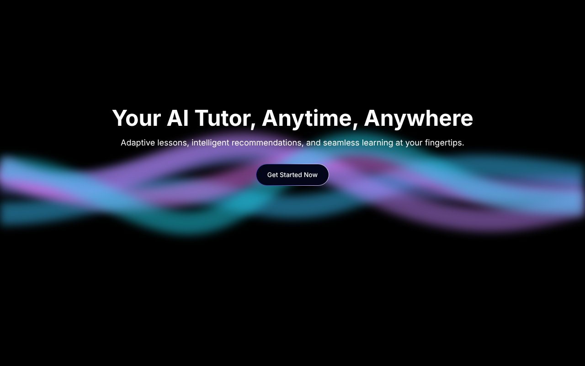

# Lerno.ai

Type a concept, get a short animated explainer back. Lerno plans the lesson as a storyboard, writes a Manim scene for each frame, renders them to video and plays them with narration. A chat tutor sits next to the video for follow-up questions.

**Live:** [lerno-peach.vercel.app](https://lerno-peach.vercel.app) (frontend; video generation needs the Python backend running, see below)



Won first place at Google Codeclash 2.0 (Gurugram, 1,000+ teams). First built at HackoWasp 7.0 by team Ctrl-Alt-Defeat (Suryansh Pratap Singh, Tejas Mehra, Swastik Dutt). [Pitch deck](https://www.figma.com/slides/2P1pYfOLMtQcbQfyhlG9fi/lerno.ai-CTRL-ALT-DEFEAT?node-id=0-239).

## How it works

```
React app ──> Node proxy (:3001) ──> FastAPI (:8000)
                                       │
                                       ├─ classify the input (topic or question?)
                                       ├─ free LLM: storyboard for the audience
                                       ├─ free LLM: narration + Manim code per scene
                                       ├─ manim renders each scene to MP4
                                       └─ upload to Firebase Storage, return URLs
```

1. **Classify.** The input is checked to see whether it is a teachable topic.
2. **Storyboard.** The LLM splits the topic into scenes pitched at the chosen audience, using Wikipedia for grounding.
3. **Scene code.** For each scene the LLM writes narration and a deliberately simple Manim `Scene` (no loops, no image assets) so it renders reliably.
4. **Render.** `manim -pql` renders every scene. Videos go to Firebase Storage.
5. **Learn.** The frontend plays the scenes in order with the narration. Gemini powers the side chat.

**No paid keys.** Out of the box every LLM call goes to Pollinations' free anonymous API. Visitors can paste their own free Gemini key in the site for faster, steadier lessons; if Gemini runs out of quota it falls back to the free model.

## Stack

| Layer | Tech |
| --- | --- |
| Frontend | React, TypeScript, Vite, Tailwind, Aceternity UI components, Framer Motion |
| Proxy | Node.js, Express |
| Generation | FastAPI, Pollinations (free, no key) or your own free Gemini key |
| Animation | Manim Community, Cairo |
| Storage | Firebase Storage |

## Run it locally

You need Node 18+, Python 3.10+, and Manim's system deps (Cairo, Pango, ffmpeg).

```bash
cd Lerno.ai-main
npm install
npm run dev                         # frontend on :5173

cd backend
npm install && node server.js       # proxy on :3001

pip install -r requirements.txt
uvicorn main:app --port 8000        # generator on :8000
```

Create `Lerno.ai-main/backend/.env`:

```
# all optional, Lerno runs with no keys
GEMINI_API_KEY=...        # faster lessons, free from aistudio.google.com
POLLINATIONS_TOKEN=...     # higher free rate limits
```

Firebase Storage needs a service account JSON in `backend/` (see `main.py`).

## Layout

```
Lerno.ai-main/
  src/components/   LandingPage, LearningPage, AIChatbot, input
  src/ui/           animated UI pieces
  backend/main.py   storyboard, Manim codegen, render, upload
  backend/server.js proxy from the frontend to FastAPI
```
